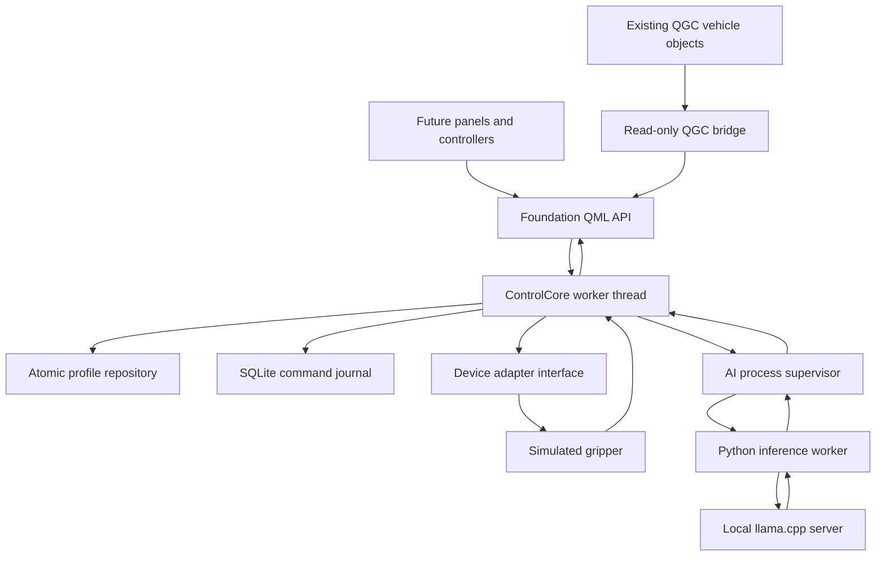

# Yousif Control Center: infrastructure implementation

This branch adds a working application core and a real local-AI connection. It does not claim to complete the entire Implementation Blueprint v1. Existing panels and schema-1 example profiles remain in place. The new API is `Yousif.Foundation 1.0`.

## What runs now

| Component | Implementation | Boundary |
|---|---|---|
| Device configuration | Strict schema-2 profiles, unique device/binding IDs, bounded endpoint values, revision-checked atomic saves | Simulation grippers only; these are not flight-controller parameters |
| Control coordinator | Immutable proposals, exact approval hash, session/revision/expiry checks, device ownership, request deduplication | No physical actuator adapter installed |
| Feedback | Separate Dispatched, Accepted, Completed, Failed, Unknown states | Simulated position feedback is explicitly marked nonphysical |
| Persistence | SQLite transactional request/event journal, exclusive process lock, restart reconciliation | No automatic replay of unfinished commands; retention/export not implemented |
| QGC observation | Active vehicle ID, firmware, armed state, flight mode and link-loss state copied on the UI thread | Read-only; full QGC build and live-vehicle acceptance remain separate gates |
| Local AI | Python worker calls a loopback llama.cpp server; C++ supervises and validates replies | Text answers are generated/unverified; action proposals require operator approval |
| QML integration | Singleton with asynchronous requests, snapshots and result signals | No new panels or changes to existing panel behavior |
| Diagnostics | Headless executable exercises the same coordinator and asks the same AI worker | Not a replacement flight controller |

## How the pieces communicate



QGC stays responsible for existing flight communication, parameters, firmware behavior and controls. The new core never opens a second MAVLink connection. It never writes a raw motor or servo channel. The AI worker receives JSON copies, not a Vehicle pointer or an execution token.

`Foundation` is the one application-facing composition root. Its worker owns `ControlCore`, the SQLite connection, timers and `AiSupervisor`. All core mutations are serialized on that worker thread. QGC objects stay on the UI thread. UI responses cross threads as copied JSON/variants. Model computation is in a separate local server process.

The process split provides fault isolation, not an operating-system security sandbox. Python runs with the same user's permissions. Configure only a trusted local script/runtime.

## File ownership

| Directory/file | Responsibility |
|---|---|
| `custom/src/domain/Contracts.*` | IDs, error envelopes, bounded JSON parsing, strict profiles |
| `custom/src/configuration/ProfileRepository.*` | Profile loading and revision-checked atomic persistence |
| `custom/src/recording/EventJournal.*` | Durable request identity, state history and restart recovery |
| `custom/src/application/ControlCore.*` | Session, proposal, approval, ownership and dispatch rules |
| `custom/src/adapters/simulation/SimulatedGripper.*` | Device interface plus simulated ACK/feedback and failures |
| `custom/src/adapters/QgcReadBridge.cc` | Read-only QGC observation, compiled into the main app |
| `custom/src/ai/AiSupervisor.*` | Process lifecycle, bounded framing, correlation and deadlines |
| `custom/src/presentation/Foundation.*` | Thread composition and QML-facing API |
| `custom/ai/worker.py` | Local provider, constrained JSON request and independent response validation |
| `custom/foundation/CMakeLists.txt` | Independently buildable core, QML module, tests and diagnostic executable |
| `custom/tests/` | Deterministic core, QML registration, hostile worker and provider tests |
| `custom/tools/foundation_cli.cc` | Diagnostic client using production core classes |
| `custom/tools/evaluate_local_ai.py` | Repeatable real-model evaluation; never executes commands |

The Python service is kept under `custom/ai/` so this first implementation remains together with the fork's custom code. It is still a separate process, not code embedded into a QML panel. No upstream source file is modified by this branch.

## Configuration contract

Use `custom/profiles/examples/sim-gripper-v2.json` as a complete schema-2 input. Every field is required; unknown fields are rejected. Revision 0 creates a profile. A successful save increments the revision. The next save must provide the current revision both inside the draft and as `expectedRevision`.

Each device has its own UUID, name, simulated binding UUID and endpoints. `minimum <= openPosition/closePosition <= maximum` must hold; the range is normalized 0–1 and the two endpoints must differ. Duplicate IDs or bindings are rejected. A binding UUID is **not a servo channel**. Changing 0.9 to 0.8 changes the simulated open target; it does not magically calibrate a physical gripper.

The old schema-1 example files remain educational inspector inputs. They are not silently promoted to executable profiles. Physical profiles need a new, verified adapter contract with firmware-specific mapping, output-conflict checks, calibration and feedback evidence. Those cannot be supplied by renaming a JSON key.

Profiles live below the application's local data directory, in `foundation-v1/profiles/`. The SQLite journal lives beside them. The CLI uses its own application directory or an explicit `--data` path. Source files and runtime configuration are separate. Application-data location is provided by Qt on each OS.

## API for future panels

```qml
import Yousif.Foundation 1.0

// This sends an asynchronous request. The returned UUID correlates the response.
const callId = Foundation.request("snapshot", {})
```

`Foundation.snapshot` is observable state. `Foundation.aiReady` means the Python protocol worker is available; it does not certify that a model server is reachable or that a model is accurate. An unavailable server produces `AI_INFERENCE_ERROR` on an inference request.

Signals:

- `response(callId, result)` answers an API request.
- `aiResult(turnId, result)` answers the separate, longer-running inference operation.
- `commandChanged(outcome)` reports acknowledgement or feedback transitions.
- `snapshotChanged()` and `aiReadyChanged()` notify property changes.

All operation argument objects use exactly the fields listed below. Results are either `{"ok":true,"value":{...}}` or `{"ok":false,"error":{"code":"...","message":"..."}}`.

| Operation | Arguments | Result/use |
|---|---|---|
| `snapshot` | `{}` | Current session, capabilities and storage status |
| `profile.save` | `draft`, `expectedRevision` | Validated saved profile with new revision |
| `profile.load` | `profileId` | Current persisted profile |
| `simulation.connect` | `profileId` | New simulation session; blocked while a real QGC vehicle is observed |
| `session.disconnect` | `{}` | Closes the foundation session; does not disconnect a QGC radio |
| `action.propose` | `capabilityId`, `arguments` | Preview; gripper arguments must be `{}` |
| `action.approve` | `proposalId`, `proposalHash` | Operator approval token |
| `action.execute` | `requestId`, `proposalId`, `approvalId` | Durable dispatch result; repeated same request retrieves previous result |
| `action.outcome` | `requestId` | Latest journalled outcome |
| `events` | `{}` | Most recent 100 command events |
| `ai.start` | `python`, `script`, `endpoint` | Starts trusted worker using absolute executable/script paths |
| `ai.ask` | `prompt` | Returns a turn ID; listen for `aiResult` |
| `ai.stop` | `{}` | Kills worker and cancels pending inference |

Display the proposal's actual device/action and backend before calling `action.approve`. Do not call approve automatically from `aiResult`. Only the core creates approval tokens. AI JSON has no approval/execute field. Text responses carry `verifiedFact:false`; render numeric status directly from snapshots, not model prose.

## Complete command example

1. Save a schema-2 profile at revision 0; the repository returns revision 1.
2. Connect its simulation profile. The core creates a fresh session UUID and exposes one open/close capability per device.
3. Ask the model to open the cargo gripper, or let a button call `action.propose` directly.
4. The model returns a capability ID. The worker validates the output, and the supervisor checks correlation, session and configuration revision.
5. The core creates a 30-second proposal. AI-originated proposals carry the inference turn ID, which is retained in the command journal.
6. The operator reviews the exact proposal hash and approves it.
7. Execution rechecks the proposal, reserves the device and commits dispatch intent to SQLite **before** calling the adapter.
8. Simulated ACK changes state to Accepted. Matching simulated position feedback changes it to Completed with `physicalVerification:false`.
9. Missing ACK/feedback becomes Unknown after two seconds. Rejection becomes Failed. A session change makes unresolved operations Unknown.
10. A repeat with the same request UUID and payload retrieves the stored outcome, without another dispatch. A changed payload with that UUID is rejected.

The simulator has deterministic rejection, missing-ACK and missing-feedback modes for tests. It is not a flight dynamics simulator and does not prove aircraft behavior. A process restart marks unfinished requests Unknown; it never resends them.

## AI protocol and limits

Transport is newline-delimited JSON over the Python process's stdin/stdout. Every envelope has `version:1`. The worker sends `hello`, then a heartbeat every second. The host permits one inference at a time. Frames are bounded to 64 KiB, the input prompt to 4096 characters, and generated text to 8192 characters. Unknown/duplicate JSON keys, unexpected envelopes, uncorrelated replies and oversized output are rejected.

The watchdog allows five seconds without a heartbeat and 100 seconds for an inference response. The HTTP provider uses a 90-second timeout. Cancellation kills the worker; starting again is explicit. Old responses never receive execution authority. A missing model/server does not stop QGC's existing controls.

The server endpoint must be literal loopback HTTP with an explicit port. Proxy forwarding and HTTP redirects are disabled. No paid/cloud fallback exists. Model inference is real, but this does not make model suggestions reliable: an available capability can still be the wrong interpretation of a request. Operator review is mandatory. The checked-in evaluation records semantic mistakes rather than hiding them.

No camera frames, detector, tracking, speech recognition, speech synthesis, persistent conversation memory or autonomous mission planner are implemented in this package. They are separate blueprint stages. Camera-looking prose from a language model is not a camera observation.

## Build and run on your Mac

Keep your current checkout and build intact. If the delivery branch has been pushed, fetch it into a separate Git worktree. If using the supplied download package instead, follow its `START_HERE.md` to import the bundle first, then continue with `source` below:

```bash
cd "$HOME/Developer/drone-project/repos/qgroundcontrol"
git fetch origin codex/ai-foundation
git worktree add ../control-center-ai origin/codex/ai-foundation
source "$HOME/Developer/drone-project/tools-env/bin/activate"
cd "$HOME/Developer/drone-project/repos/control-center-ai"

cmake -S custom/foundation \
  -B "$HOME/Developer/drone-project/builds/foundation-mac-debug" \
  -DCMAKE_PREFIX_PATH="$HOME/Developer/SDKs/Qt/6.11.1/macos" \
  -DCMAKE_BUILD_TYPE=Debug
cmake --build "$HOME/Developer/drone-project/builds/foundation-mac-debug" --parallel 2
ctest --test-dir "$HOME/Developer/drone-project/builds/foundation-mac-debug" --output-on-failure
python -m unittest discover -s custom/tests -p 'test_*.py' -v
```

The worktree is another source folder sharing Git history. It avoids overwriting local changes, including any ProfilePreferences work that has not been pushed. This small build tests the core without rebuilding all of QGC.

Run the simulated device path:

```bash
"$HOME/Developer/drone-project/builds/foundation-mac-debug/ycc-foundation" \
  --data "$HOME/Developer/drone-project/data/foundation-check" \
  --profile custom/profiles/examples/sim-gripper-v2.json \
  --exercise
```

Expect Dispatched → Accepted → Completed and normalized position 0.9. Re-run with the same state directory to verify persistence. Existing revisions are not overwritten by this diagnostic. The CLI snapshot shows what profile is actually loaded.

The full QGC app uses the same libraries through `custom/CMakeLists.txt`. Build it in a **new** build directory with your existing Qt/GStreamer configuration; do not point an old CMake build at a different source worktree. Full application launch is an acceptance gate, not something standalone tests prove.

## Run real local AI

Use a trusted llama.cpp runtime and a compatible GGUF model. Evidence in this branch records the exact runtime commit, model hash and actual test results. Model weights are deliberately excluded from Git. A small model's size is not evidence of adequate reasoning quality.

To reproduce the tested candidate download (about 1.12 GB, checksum verified):

```bash
python custom/tools/download_ai_model.py \
  --output "$HOME/Developer/drone-project/downloads/qwen2.5-1.5b-instruct-q4_k_m.gguf"
```

If llama.cpp is not installed, build the tested runtime separately using the already installed CMake and Git:

```bash
git clone https://github.com/ggml-org/llama.cpp.git "$HOME/Developer/drone-project/repos/llama.cpp"
git -C "$HOME/Developer/drone-project/repos/llama.cpp" checkout 5aeac37a35b44fde4bdffaec9159f2fcb253b622
cmake -S "$HOME/Developer/drone-project/repos/llama.cpp" \
  -B "$HOME/Developer/drone-project/builds/llama" \
  -DCMAKE_BUILD_TYPE=Release -DLLAMA_BUILD_TESTS=OFF \
  -DLLAMA_BUILD_EXAMPLES=OFF -DLLAMA_BUILD_SERVER=ON -DLLAMA_BUILD_UI=OFF
cmake --build "$HOME/Developer/drone-project/builds/llama" --target llama-server --parallel 2
```

The executable is normally under that build's `bin/` directory (multi-configuration Windows builds add a configuration directory). Use its full path in place of `llama-server` below. Stop a build or reduce parallelism if your 8 GB Mac is under memory pressure; the Linux timing report is not a Mac resource guarantee.

Start a local server (use your absolute model path):

```bash
llama-server -m /absolute/path/to/model.gguf --host 127.0.0.1 --port 8080 -c 4096 -np 1
```

In another terminal, from the source worktree:

```bash
"$HOME/Developer/drone-project/builds/foundation-mac-debug/ycc-foundation" \
  --data "$HOME/Developer/drone-project/data/foundation-check" \
  --profile custom/profiles/examples/sim-gripper-v2.json \
  --python "$(command -v python)" \
  --worker "$PWD/custom/ai/worker.py" \
  --prompt "Open the cargo gripper"
```

This outputs a proposal and exits. It does not approve or execute that proposal. The AI process can later be started through the same Foundation API by an AI settings panel. The llama.cpp server lifecycle is currently operator-managed; packaged runtime/model installation is not implemented.

Repeat the measured cases on your M1:

```bash
python custom/tools/evaluate_local_ai.py \
  --endpoint http://127.0.0.1:8080 \
  --output "$HOME/Developer/drone-project/notes/local-ai-m1-evaluation.json"
```

On Windows use the same CMake project with Qt's MSVC kit and build configuration `Debug`. Multi-configuration generators put executables under `Debug/`; run CTest with `-C Debug`. The focused GitHub workflow checks the core on Linux, macOS and Windows; see its actual result before claiming a platform passes.

## What remains before physical use

- Validate the complete QGC build and read bridge against the exact firmware/SITL setup; extend timestamped telemetry through QGC Facts.
- Inventory and integrate or explicitly exclude every legacy QGC write path. Existing QGC buttons and joystick commands are **not** governed by this new coordinator.
- Implement named firmware/device adapters, real output mapping, motor/output conflicts, bounded calibration, sensor feedback verification and hardware acceptance tests.
- Add durable vehicle identity matching. MAVLink system ID and this connection session UUID are not permanent physical identity.
- Implement controller adapters, deadman behavior, handover and renewal rules. The current lease mechanism is a core primitive, not a complete RC/glasses controller.
- Complete factual answer rendering, ambiguity handling, adversarial evaluation and M1 resource/latency measurement before treating a model as an operational assistant.
- Add video/frame contracts and detector evaluation before camera boxes; onboard recording/execution and underwater navigation before offline missions.
- Add profile discovery/deletion/migrations, recovery UI, calibration records, log retention/export, installation/update/uninstallation and signed packages.

Changing numbers is sufficient only for a supported adapter's calibrated configuration. Adding a new hardware class still requires implementation and verification. Laptop loss cannot be handled by a laptop AI: flight stabilization and configured link-loss behavior must remain onboard.

## Verification and licences

See `IMPLEMENTATION_RESULTS.md` and `evidence/` for actual results and open gates. Tests include production core paths and hostile worker fixtures, explicitly separate from real model inference.

Retain the existing QGC/Qt notices and comply with their licences. llama.cpp and model weights have their own licences. This branch does not copy model weights or third-party runtime code into the repository, and does not assume that future replacement removes present obligations.
